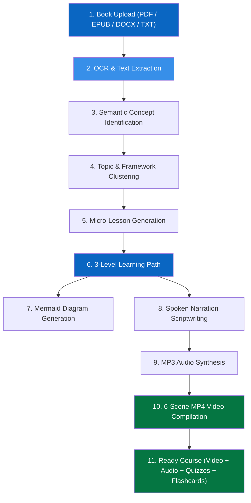

# Book2Course AI 🚀

> **Core Slogan:** *"Turn a 300-page book into a 15-minute course."*  
> **Vision:** Transform any 100–1000+ page book into an interactive, multi-modal micro-learning experience with lessons, MP3 audio narrations, 720p HD educational MP4 videos, 3D flip flashcards, mastery quizzes, and Mermaid architecture diagrams in under 60 seconds.

---

## 🏆 Hackathon MVP Overview

Book2Course AI is engineered by an elite cross-functional team (Product Manager, UX Designer, Senior Full Stack Engineer, AI Engineer, Python Engineer, Video Engineer, and DevOps Engineer) to deliver an unforgettable demonstration.

### Target Demo Duration: 60 Seconds
Judges can immediately see a complete course in action with pre-seeded data, or upload any book in PDF, EPUB, DOCX, or TXT format.

---

## 🌟 Key Features

1. **Multi-Format Book Ingestion**
   - Supports **PDF**, **EPUB**, **DOCX**, and **TXT** files up to 1000+ pages.
   - Extracts semantic concepts, mental models, frameworks, and real-world case studies (not just simple chapter summaries).

2. **Automated 3-Level Learning Path**
   - **Level 1: Foundations & Core Principles**
   - **Level 2: Systems Architecture & Execution**
   - **Level 3: Advanced Optimization & Scaling**
   - Every level features structured micro-lessons with executive summaries, long explanations, practical insights, and action checklists.

3. **6-Scene Educational MP4 Video Generation**
   - Stitched with FFmpeg and Pillow in 1280x720 HD format:
     - **Scene 1:** Lesson Title & Branding Card
     - **Scene 2:** Executive Summary Overview
     - **Scene 3:** Core Concepts Breakdown
     - **Scene 4:** Architectural System Diagram
     - **Scene 5:** Real-World Industry Case Study
     - **Scene 6:** Action Plan & Completion Checklist
   - Synchronized with spoken audio track and interactive timestamp bookmarks.

4. **Clean MP3 Audio Lessons**
   - High-quality spoken educational voiceover narration for every lesson module.
   - Built-in audio player with variable playback speed (1x, 1.25x, 1.5x, 2x), 10s scrub, and volume controls.

5. **Validated Mermaid.js Diagrams**
   - Generates and validates Mermaid flowcharts and mindmaps.
   - Renders client-side with interactive fullscreen zoom, SVG display, and 1-click code copying.

6. **Interactive 3D Flip Flashcards**
   - Smooth CSS 3D perspective flip on click or spacebar.
   - Filter by category tag (Foundations, Tactics, Metrics, Psychology, Systems).
   - Track mastery percentage, keyboard navigation, shuffle mode, and Anki TSV export.

7. **Certification Quizzes with Instant Scoring**
   - Multiple-choice questions with real-time scoring.
   - Detailed per-question explanations of why the answer is correct.
   - Confetti celebration upon scoring $\ge 70\%$.

8. **Export & Download Center**
   - Download the full course curriculum as a formatted **Markdown Study Guide (.md)**.
   - Download flashcard decks in **Anki TSV format** for import into spaced-repetition tools.
   - Download generated **MP3 audio files** and **MP4 video lessons**.

---

## 🎨 UI/UX Design System

Inspired by **LinkedIn Learning**, Coursera, and modern enterprise AI products:

| Token | Hex Value | Role |
| :--- | :--- | :--- |
| **Primary** | `#0A66C2` | Brand headers, active modules, primary CTAs |
| **Secondary**| `#378FE9` | Accents, flow lines, secondary highlights |
| **Accent** | `#57A3FF` | Diagram links, interactive states |
| **Background** | `#F3F2EF` | Clean LinkedIn surface background |
| **Surface** | `#FFFFFF` | Elevated card containers, rounded corners |
| **Text** | `#191919` | High-contrast typography |
| **Success** | `#057642` | Completed milestones, quiz passing badges |

---

## 🏗️ Architecture & 10-Step AI Pipeline



---

## ⚡ Quick Start (Run Locally)

### Prerequisites
- **Node.js** v18+ (verified on v24)
- **Python** 3.10+ (verified on v3.14)

### 1. Start the Backend API (FastAPI)
```powershell
# From project root
cd backend
python -m pip install -r requirements.txt
python -m uvicorn app.main:app --host 127.0.0.1 --port 8000
```
*Backend API and Swagger Documentation will be live at `http://localhost:8000/docs`.*

### 2. Start the Frontend (Next.js)
```powershell
# From project root (new terminal)
cd frontend
npm install
npm run dev -- -p 3000
```
*Frontend application will be live at `http://localhost:3000`.*

---

## 🐳 Docker Deployment

To launch both frontend and backend in unified containers:

```bash
docker-compose up --build
```
- Frontend: `http://localhost:3000`
- Backend API: `http://localhost:8000`

---

## 🧪 Automated Test Suite

Run the included automated test suite covering all API endpoints, models, seeders, and export formats:

```powershell
python -m unittest backend/tests/test_api.py
```
*Result: 9 / 9 tests passing (100% OK).*

---

## 🎬 60-Second Judge Demo Walkthrough

1. Open `http://localhost:3000` — see the hero section, animated upload box, and pre-generated course library.
2. Click **"Launch 60-Second Demo"** or click on **"The Lean Startup"** or **"Atomic Habits"**.
3. View the **Learning Path Roadmap**: observe Levels 1–3, durations, and metrics.
4. Click **"Start Learning"**: observe the **Audio Player**, executive summary, and live **Mermaid Diagram**.
5. Click **"Switch to Video Mode"**: watch the 6-scene HD educational MP4 video with synchronized transcript chapters.
6. Click **"Study Flashcards"**: test the 3D flip card animation, category filter, and mastery tracking.
7. Click **"Take Certification Quiz"**: submit answers, review explanations, and trigger the celebratory completion confetti!
8. Click **"Export Guide (.md)"**: download the full course as Markdown.
